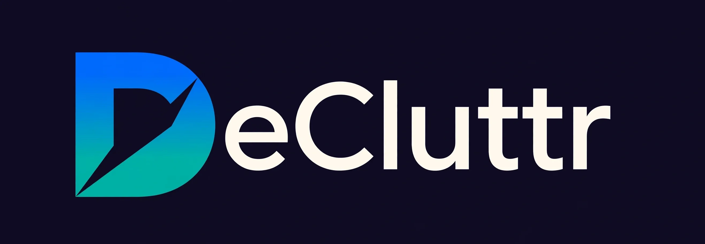

# DeCluttr



Web3 wallet management on **Base** — a phone-first dashboard for watching wallets, auditing token approvals, cleaning up dust, browsing NFTs, and catching security-relevant changes.

*Your wallet, minus the mess.*

Built by Robert Collier.

## Features

- **Dashboard** — per-wallet balances, USD net worth, NFT summary card (count + combined floor estimate)
- **NFTs tab** — artwork gallery sorted by estimated value (floor × quantity), detail view with collection, token ID, traits, and copyable contract address
- **Approvals** — token approval scan with unlimited-allowance flagging and one-click revokes
- **Cleanup** — dust & suspect-token review queue
- **Watch** — 60-second watch-mode alerts on watched wallets
- **Wallet connect** — WalletConnect QR pairing (Reown) with injected-provider fallback

## Stack

- **Client:** React 19 + TypeScript, wagmi/viem, Reown AppKit (WalletConnect), TanStack Query, Tailwind CSS v4
- **Server:** Bun + TypeScript, Hono, Drizzle ORM (SQLite)
- **Chain:** Base (8453)

## Setup

Prerequisites: [Bun](https://bun.sh) 1.3+.

```bash
git clone https://github.com/BobbyxBase/decluttr.git
cd decluttr
bun install
bun run dev
```

Open http://localhost:3000. The server creates `./data/decluttr.db` (SQLite) and runs the Drizzle migrations automatically on first boot.

To build the production client bundle:

```bash
bun run build   # emits client/dist/
```

Then `bun run dev` serves the built bundle (or run with `NODE_ENV=production`).

Set `PORT` to change the listen port (default 3000).

Set `BASE_RPC_URL` to your own Base JSON-RPC HTTPS endpoint (e.g. Alchemy or
Infura) for more reliable chain reads. Without it the server rotates through
a few public RPCs.

Full-history import (approvals + token activity) runs through the free
[Blockscout API](https://base.blockscout.com) — no key needed. Free RPC tiers
cap `eth_getLogs` at ~10 blocks per request, which makes a pure-RPC history
scan infeasible; the explorer import fetches a wallet's transaction and
transfer lists directly instead (dozens of calls, not millions). If the
explorer is unreachable the server falls back to the slow RPC log scan.

## Brand assets

The logo and icon files are binary, so they ship separately from git. To add
them:

1. Get the files from the maintainer:
   - `brand/decluttr-lockup.webp` — the repo header / social lockup
   - `client/public/icon-512.png`, `client/public/icon-192.png`,
     `client/public/apple-touch-icon.png`, `client/public/favicon-32x32.png`
2. Drop the lockup into `brand/` and the four PNGs into `client/public/`
   (create the folders if they don't exist).
3. Run `bun run build` — the build copies `client/public/` into the served
   bundle automatically.

`icon-192.png` appears in the app header; the favicons are wired up in
`client/index.html`. Without the PNGs the app still runs, just without the
branded icons.

## Project layout

```
client/
  src/           React app (App.tsx, api.ts, wallet.ts, theme.css)
  index.html     HTML shell
  build.mjs      Tailwind + Bun.build pipeline -> client/dist/
server/
  src/
    index.ts     Hono server: POST /api/<action>, /blobs/*, static client
    actions.ts   Business logic — one handler per action (ported verbatim)
    ctx.ts       Standalone action context { db, blobs }
    db.ts        SQLite open + migration runner
    schema.ts    Drizzle schema
drizzle/         SQL migrations (run automatically on boot)
data/            SQLite db + cached NFT artwork (gitignored)
```

## API

`POST /api/<actionName>` with a JSON body of the action's args, e.g.:

```bash
curl -X POST http://localhost:3000/api/getOverview \
  -H 'content-type: application/json' -d '{}'
```

Actions: `getOverview`, `listNfts`, `listApprovals`, `addWallet`, `removeWallet`, `setTokenHidden`, `updateSettings`, `pollWatch`, `markAlertsRead`, `loadNftArtwork`.

## Notes

- This project was ported from a Hatch artifact build to run fully standalone — no Hatch runtime required.
- The Reown project ID in `client/src/wallet.ts` is a public identifier by design; swap in your own if you fork.
- Price data comes from CoinGecko's free API; NFT indexing uses Alchemy's public demo endpoint with an on-chain transfer-scan fallback.
